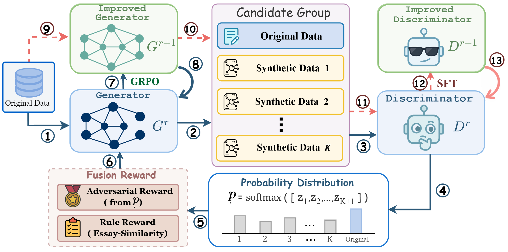

# Improving Synthetic Data Generation for Argument Mining via Adversarial Reinforcement Learning

**ARL-AM** is a research implementation of adversarial reinforcement learning for synthetic argument-mining data generation. It supports AAEC, AbstRCT, and CDCP, with both 5% and 100% training-data settings.

This README describes the files and command-line interfaces currently included in this release. Model weights and some training inputs must be supplied separately. See [Release Notes](#release-notes) for the differences between the current implementation and the method described in the paper.

## Table of Contents

- [Abstract](#abstract)
- [Framework](#framework)
- [Project Structure](#project-structure)
- [Installation](#installation)
- [Data](#data)
- [Quick Start](#quick-start)
- [Configuration](#configuration)
- [Outputs and Resume](#outputs-and-resume)
- [Downstream Argument Mining](#downstream-argument-mining)
- [Release Notes](#release-notes)
- [Acknowledgments and Licensing](#acknowledgments-and-licensing)

## Abstract

Argument Mining (AM) is fundamentally constrained by the scarcity of high-quality structure-annotated datasets.
While LLMs have shown promise in synthetic data generation, producing synthetic AM data that is both structurally accurate and sufficiently diverse remains a challenging problem.
To address this problem, we revisit synthetic data generation for AM from a new perspective and propose a novel adversarial reinforcement learning framework for data synthesis.
The proposed framework jointly optimizes the generator and the discriminator in an adversarial loop, in which the generator produces structured AM instances, and the discriminator provides learning signals by distinguishing real data from synthetic candidates. This enables the generator to progressively improve both the structural accuracy of generated argument data while maintaining diversity through adversarial feedback.
Extensive experiments demonstrate that the proposed framework consistently improves AM performance on three benchmark datasets in both full-data and low-resource settings, validating its effectiveness and scalability.

## Framework



The workflow consists of three training stages:

1. **Generator initialization:** learn a mapping from an original labeled sample to a paired synthetic labeled sample.
2. **Discriminator initialization:** identify the original sample in a shuffled group containing one original and three synthetic candidates.
3. **Adversarial evolution:** alternate generator GRPO updates with discriminator supervised refinement on newly sampled candidates.


## Project Structure

```text
ARL-AM/
|-- README.md
|-- Framework.png
|-- requirements.txt
|-- src/
|   |-- am_prompts.py                 # Shared schemas, annotation rules, and prompts
|   |-- Gene_SFT.py                   # Generator supervised fine-tuning
|   |-- Gene_launcher.py              # Generator SFT configuration and launch
|   |-- Disc_SFT.py                   # Discriminator supervised fine-tuning
|   |-- Disc_launcher.py              # Discriminator SFT configuration and launch
|   |-- GAN_min_2re.py                # Alternating GRPO and discriminator refinement
|   `-- GAN_min_2re_launcher.py        # Adversarial training configuration and launch
|-- Data/
|   |-- data_mrp/
|   |   |-- aaec_essay_5percent/
|   |   |-- aaec_essay_100percent/
|   |   |-- abstrct_5percent/
|   |   |-- abstrct_100percent/
|   |   |-- cdcp_5percent/
|   |   `-- cdcp_100percent/
|   `-- Data_other/
|       |-- aaec_essay/aaec_essay_5_gene.jsonl
|       |-- abstrct/abstrct_5_gene.jsonl
|       `-- cdcp/cdcp_5_gene.jsonl
`-- graph_parser/                     # Downstream ST argument-mining implementation
```

Additional original-format files are stored under `Data/data_mrp/`. The launchers select the percentage-specific JSONL files shown above.


### Setup

Open a terminal in the `ARL-AM` directory. The following commands use Bash syntax and target the recorded Linux environment:

```bash
python -m venv .venv
source .venv/bin/activate
python -m pip install -r requirements.txt
python -m pip check
python -c "import torch; print(torch.__version__, torch.version.cuda, torch.cuda.is_available())"
```

## Data

### Dataset Names and Available Splits

Use `aaec_essay`, `abstrct`, or `cdcp` with `--dataset`. 

The counts below describe the checked-in JSONL files:

| Dataset | CLI name | 5% train | 100% train | Validation | Test | Included 5% generator SFT targets |
|---|---|---:|---:|---:|---:|---:|
| AAEC | `aaec_essay` | 15 | 289 | 32 | 80 | 15 |
| AbstRCT | `abstrct` | 18 | 350 | 50 | 100 | 18 |
| CDCP | `cdcp` | 27 | 520 | 58 | 150 | 27 |


### Annotation Format

Each JSONL line is one complete sample. The bundled generator SFT inputs and targets use anchor-node annotations, for example:

```json
{
  "id": "example_0",
  "input": "Debt collectors should verify debts.",
  "framework": "cdcp",
  "nodes": [
    {"id": 0, "label": "CDCP_policy", "anchors": [{"from": 0, "to": 36}]}
  ],
  "edges": [],
  "tops": [0]
}
```


## Quick Start

### 1. Initialize the Generator

This example uses the bundled 5% AbstRCT pairing:

```bash
python src/Gene_launcher.py \
  --dataset abstrct \
  --few_shot 5 \
  --gpu_id 0 \
```

### 2. Initialize the Discriminator

```bash
python src/Disc_launcher.py \
  --dataset abstrct \
  --few_shot 5 \
  --gpu_id 0 \
```

### 3. Run Adversarial Evolution


```bash
python src/GAN_min_2re_launcher.py \
  --dataset abstrct \
  --few_shot 5 \
  --gpu_id 0 \
```


## Downstream Argument Mining

The [graph_parser](graph_parser/README.md) directory contains the ST argument-mining implementation. 

```bash
cd graph_parser
python run_iter_step_pretrain.py --dataset abstrct --few_shot 5 --gpu_id 0 
```

## Acknowledgments and Licensing

This project builds on the AAEC, AbstRCT, and CDCP corpora and the included ST graph parser. Preserve the corresponding dataset and upstream attribution notices when redistributing their files.

The downstream parser includes its own [license](graph_parser/LICENSE), identifying Attribution-NonCommercial-ShareAlike 4.0 International terms. A top-level license for the new synthesis code is not included in this snapshot. Model weights and original corpora retain their respective licensing terms.
